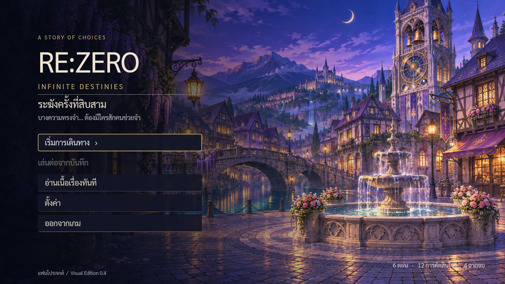
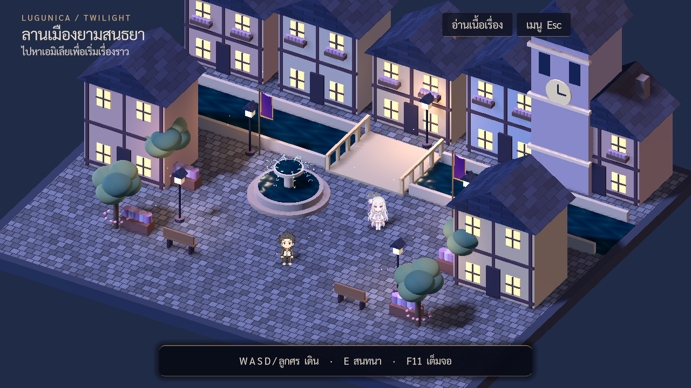
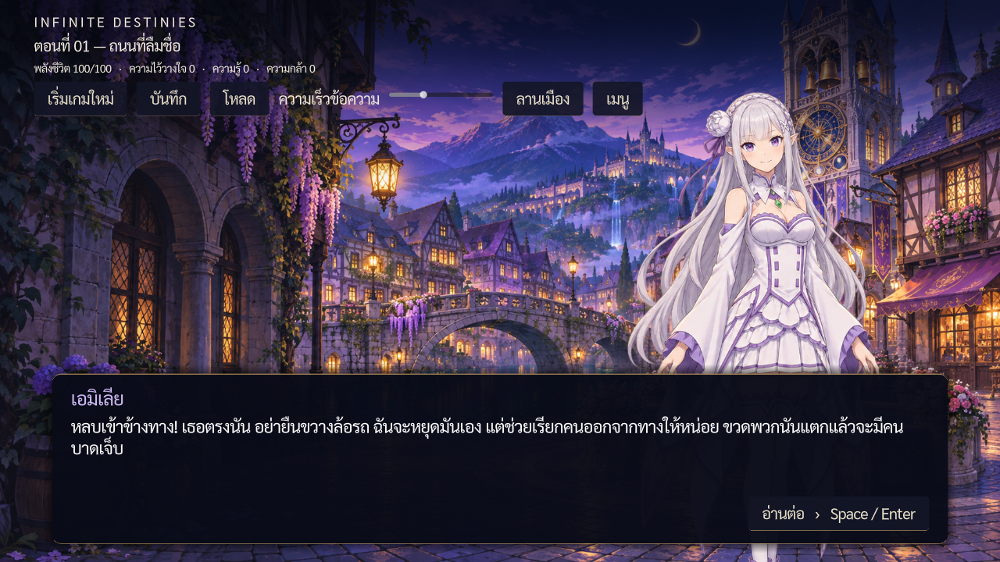

# RE:ZERO — INFINITE DESTINIES

**Living Town Edition 0.5 · เกมเนื้อเรื่องภาษาไทย · Windows / Linux**

[ดาวน์โหลดเกม Windows](https://github.com/ranksteam02-star/RE_ZERO_INFINITE_DESTINIES/raw/refs/heads/downloads-v0.5.0/InfiniteDestinies-Windows-v0.5.0.zip) · [ดาวน์โหลดเกม Linux](https://github.com/ranksteam02-star/RE_ZERO_INFINITE_DESTINIES/raw/refs/heads/downloads-v0.5.0/InfiniteDestinies-Linux-v0.5.0.zip) · [Releases](https://github.com/ranksteam02-star/RE_ZERO_INFINITE_DESTINIES/releases)

## เปิดเล่นโดยไม่ต้องติดตั้ง Godot

1. ดาวน์โหลด **InfiniteDestinies-Windows-v0.5.0.zip** จาก Releases (อย่าเลือก Source code ถ้าต้องการเล่นทันที)
2. แตก ZIP ทั้งหมด แล้วเปิด **InfiniteDestinies.exe**
3. เลือก **เริ่มการเดินทาง** เพื่อเดินในลานเมือง หรือ **อ่านเนื้อเรื่องทันที** เพื่อเข้าเรื่อง
4. กด **บันทึก** ระหว่างอ่าน ก่อนปิดเกม แล้วใช้ **เล่นต่อจากบันทึก** ในครั้งถัดไป

Windows package เป็น x86-64 สร้างด้วย official Godot 4.6.3 template และมี resource อยู่ใน executable. ไม่ต้องเปิด Editor หรือเชื่อมอินเทอร์เน็ตขณะเล่น. Runtime ใช้ Compatibility/OpenGL เพื่อรองรับเครื่องได้กว้างขึ้น

**สถานะทดสอบ:** รันทดสอบระบบและ executable Linux แล้ว; Windows executable export สำเร็จ แต่ยังไม่ได้รันบน Windows จริง



## สิ่งใหม่ใน 0.5

- ตัวละครขนาดเล็ก AnimatedSprite3D: ยืน/กะพริบตาและเดินสี่ทิศ พร้อมเฟรมแขนขาแยกจริง
- พื้นหินสลับแนว หลังคากระเบื้อง ต้นไม้ ม้านั่ง กระถางหน้าต่างและเงาใต้ตัวละคร
- คลื่นน้ำเคลื่อนไหว ละอองน้ำพุและธงไหว
- รูปแบบภาพยังเป็น stylized prototype; แผนที่และเนื้อเรื่องเท่าเดิมในรุ่นนี้



[คลิปเดินสี่ทิศจากเกมจริง](https://github.com/ranksteam02-star/RE_ZERO_INFINITE_DESTINIES/raw/refs/heads/downloads-v0.5.0/motion-preview.mp4)

## ระบบจาก 0.4

- ภาพเมืองแฟนตาซียามสนธยาและภาพสุบารุ/เอมิเลียที่สร้างขึ้นใหม่สำหรับเกม
- หน้าเริ่มเกม, เล่นต่อจาก Save, เมนูตั้งค่า และกรอบบทสนทนาใหม่
- ลานเมือง 2.5D ขนาดเล็ก: ฉาก 3D + ตัวละคร Sprite3D, กล้อง Orthographic, น้ำพุ, สะพาน, หอระฆัง, แสงโคม และอนุภาคเคลื่อนไหว
- เดินด้วย WASD/ลูกศร มี collision และกด E คุยกับเอมิเลียเมื่ออยู่ใกล้
- ดนตรีบรรยากาศแต่งใหม่, ปรับเสียง/ความเร็วข้อความ/ขนาดตัวอักษรได้และจำค่าหลังเปิดเกมใหม่
- กลับจากเรื่องไปลานเมืองหรือเมนูได้ โดยไม่เริ่มเรื่องใหม่
- Save schema เดิม v1 และ node IDs เดิมยังอยู่



## วิธีควบคุม

| ปุ่ม | การทำงาน |
|---|---|
| WASD / ลูกศร | เดินในลานเมือง |
| E | คุยกับเอมิเลียเมื่ออยู่ใกล้ |
| Space / Enter | แสดงข้อความทั้งหมด แล้วกดอีกครั้งเพื่ออ่านต่อ |
| เมาส์ / Tab + Enter | เลือกคำตอบและเมนู |
| Esc | เปิดเมนู / กลับเข้าเกม / ปิดหน้าตั้งค่า |
| F11 | สลับเต็มจอ |

## เนื้อเรื่อง

“ระฆังครั้งที่สิบสาม” มี 6 ตอน บทสนทนา 152 ช่วง จุดตัดสินใจ 12 จุด และฉากจบ 4 แบบ. หนึ่งรอบอ่าน dialogue 104 หน้า. ตัวเลือกต้นเรื่องส่งผลต่อเหตุการณ์ช่วงท้ายและเงื่อนไขฉากจบ

เกมเป็นแฟนโปรเจกต์ที่ไม่ใช่งานทางการ. บทสนทนาแต่งขึ้นใหม่; งานภาพสร้างด้วย AI ตามแนวทางแฟนโปรเจกต์; ไม่ใช้เพลงหรือไฟล์ที่ดึงจากอนิเมะ/เกมต้นฉบับ. ดู [Asset credits](docs/ASSET_CREDITS.md)

## ขอบเขตของรุ่นนี้

นี่คือ playable narrative demo พร้อมลานเมืองหนึ่งฉาก ยังไม่มีระบบต่อสู้ การย้อนเวลา แผนที่หลายพื้นที่ หรืออนิเมชันเดินหลายเฟรม. ตัวละครในเมืองเป็นภาพนิ่ง billboard ที่ขยับตาม controller. Save มีหนึ่งช่องพร้อม backup; ยังไม่มี autosave. ตำแหน่งเดินในลานเมืองไม่ถูกบันทึกข้ามการเปิดเกม

## เป้าหมายระยะยาว

Owner ต้องการเล่น 2–3 ชั่วโมงต่อวัน นาน 7–8 เดือน (เป้าหมาย 420–720 ชั่วโมง). รุ่นนี้ยังเป็นบทนำและยังไม่ถึงเป้าหมายนั้น. ดู [แผนขยายเกมและ milestone ถัดไป](docs/LONG_TERM_CAMPAIGN.md)

## สำหรับผู้พัฒนา

ใช้ Godot **4.6.3 Standard** → Import `project.godot` → F5. Main Scene ใหม่คือ `scenes/main/Game.tscn`; `Main.tscn` เป็นหน้าบทสนทนาที่ GameShell โหลดเมื่อเริ่มอ่าน

```bash
bash tests/run_all.sh
```

Windows: ตั้ง `GODOT_BIN` ไปที่ Godot console executable แล้วรัน `tests\run_all.bat`

Export presets อยู่ใน `export_presets.cfg`: ติดตั้ง official export templates 4.6.3 แล้ว export Windows Desktop หรือ Linux Desktop. Source editor คง Forward+; native exports ใช้ custom feature `release_compat` เลือก Compatibility

- [รายละเอียดรุ่น 0.4 และผลทดสอบ](docs/VISUAL_EDITION_04.md)
- [สอนเขียนเรื่อง JSON](docs/AUTHORING_TH.md)
- [คู่มือเส้นทาง — มีสปอยล์](docs/STORY_GUIDE_SPOILERS.md)
- [รูปแบบ state/save และสถาปัตยกรรมพื้นฐาน](docs/design/TDD.md)
- [ร่วมพัฒนาผ่าน Pull Request](CONTRIBUTING.md)

เอกสารที่ระบุ v0.3 เป็นบันทึกฐานก่อน Visual Edition ให้ใช้ README และ VISUAL_EDITION_04 เป็นสถานะล่าสุด
