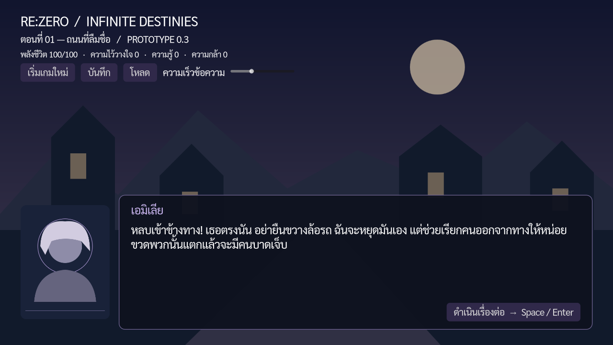

# RE:ZERO — INFINITE DESTINIES

**ต้นแบบที่เล่นได้ v0.3 · Godot 4.6.3 · GDScript · ภาษาไทย · เป้าหมาย Windows PC**

แฟนโปรเจกต์ที่ไม่ใช่งานทางการ เนื้อเรื่อง “ระฆังครั้งที่สิบสาม” และบทสนทนาใน repository นี้เขียนขึ้นใหม่ ไม่ใช่การนำบทจากอนิเมะ/นิยายมาคัดลอก ภาพเป็น placeholder ที่สร้างใหม่ ยังไม่มีเพลงหรือเสียงจากผลงานต้นฉบับ

## เริ่มเล่น

1. ดาวน์โหลด **Godot 4.6.3 Standard** (ไม่ต้องใช้ .NET)
2. Clone repository หรือใช้ **Code → Download ZIP** แล้วแตกไฟล์
3. เปิด Godot Project Manager → **Import** → เลือก `project.godot`
4. รอ import ฟอนต์และภาพเสร็จ แล้วกด **F5** เพื่อเล่น Main Scene
5. ใช้ Space/Enter หรือปุ่มด้านล่าง กดครั้งแรกเพื่อแสดงข้อความทั้งหมด กดอีกครั้งเพื่ออ่านหน้าถัดไป
6. เลือกคำตอบด้วยเมาส์ หรือใช้ Tab/ปุ่มลูกศรและ Enter
7. กด **บันทึก** เพื่อเก็บความคืบหน้า กด **โหลด** เพื่อกลับมายังบรรทัด/ตัวเลือกเดิม
8. กด **F11** เพื่อสลับเต็มจอ ปรับความเร็วข้อความด้วยแถบด้านบน

ถ้าเครื่องไม่รองรับ Vulkan: สลับ Renderer มุมขวาบนของ Editor เป็น **Compatibility** แล้วเปิดโปรเจกต์ใหม่ หรือรัน `godot --path . --rendering-method gl_compatibility`

> ที่ส่งมอบคือ source project ที่เล่นผ่าน Godot ได้ ยังไม่ได้ส่ง Windows executable และยังไม่ได้ทดสอบบน Windows จริง

## เนื้อหาที่มีแล้ว

- เรื่องใหม่ 6 ตอน: ถนนที่ลืมชื่อ → เด็กหญิงกับสะพานน้ำ → หอจดหมายเหตุที่ไม่มีหน้าสุดท้าย → สัญญาใต้หอคอย → เมืองที่ต้องจำร่วมกัน → ก่อนระฆังครั้งที่สิบสาม
- บทสนทนา 152 nodes, ตัวเลือก 12 nodes (24 คำตอบ), condition 4 nodes รวม 168 nodes
- ข้อความเรื่อง/คำถาม 26,111 ตัวอักษร ไม่รวมชื่อผู้พูดและข้อความปุ่ม
- หนึ่งรอบผ่านบทสนทนา 104 หน้า และการตัดสินใจ 12 ครั้ง; ไม่จำเป็นต้องอ่านทุกแขนงในรอบเดียว
- ฉากจบ 4 แบบ ขึ้นกับความรู้ ความไว้วางใจ การเผยแพร่หลักฐาน และวิธีจัดการวงแหวน
- ตัวเลือกต้นเรื่องเปลี่ยนบทสนทนาช่วงหลัง ไม่ได้เปลี่ยนแค่ตัวเลข
- ฉากสั้นเดิมสำหรับ regression tests ยังอยู่ใน `data/stories/chapter_01.json`

## ระบบที่ใช้งานได้

GameState Autoload, Thai dialogue/typewriter, portrait/background, data-driven branching, whitelist effects/conditions, relationship clamp, single-slot save/load, backup recovery, save validation, keyboard navigation และ New Game confirmation

Save ใช้ `user://save_01.json`; `.bak` เป็นรุ่นก่อนหน้า ไม่ใช่ autosave การโหลดอ่านจากดิสก์จริงและไม่เรียกผลของตัวเลือกซ้ำ

## ขอบเขตที่ยังไม่เสร็จ

ยังไม่มีระบบเดินสำรวจ, ฉาก 3D ที่เล่นได้, BattleManager, TimelineManager, inventory, เสียง, auto advance, backlog, ตัวเลือกแบบล็อกตามเงื่อนไข, หลายช่องบันทึก หรือเมนู settings เต็มรูปแบบ โครง World/Orthographic Camera เตรียมไว้แล้ว แต่ภาพที่เห็นตอนนี้เป็นฉากหลัง 2D

`timeline_data` และ `persistent_memory` มีช่องข้อมูลสำหรับพัฒนาต่อ ยังไม่มีการย้อนเวลา ห้ามใช้ปุ่มเริ่มเกมใหม่แทนการ reset timeline

## เอกสาร

- [เริ่มต้นและตั้งค่า Scene](docs/SETUP_TH.md)
- [สถาปัตยกรรมและรูปแบบ Save](docs/design/TDD.md)
- [เพิ่ม/แก้เนื้อเรื่องด้วย JSON](docs/AUTHORING_TH.md)
- [แนวคิดเกมและขอบเขต](docs/GDD/GDD.md)
- [ผลทดสอบและรายการตรวจบน Windows](docs/TEST_RESULTS.md)
- [เส้นทางและฉากจบ — มีสปอยล์](docs/STORY_GUIDE_SPOILERS.md)
- [แผนงานและข้อจำกัด](docs/ROADMAP.md)
- [บันทึกการพัฒนา](docs/DEVELOPMENT_LOG.md)
- [บันทึกการตัดสินใจ](docs/DECISIONS.md)
- [สิทธิ์ของทรัพยากร](docs/ASSET_CREDITS.md)

## รันทดสอบ

Linux/macOS ที่มี Godot ใน PATH:

```bash
bash tests/run_all.sh
```

Windows Command Prompt:

```bat
set "GODOT_BIN=C:\Tools\Godot_v4.6.3-stable_win64_console.exe"
tests\run_all.bat
```

ทดสอบระบบหลัก 43 รายการ ไล่ชุดตัวเลือกทั้ง 4,096 รูปแบบ และทดสอบ Save ข้าม process โดยใช้ไฟล์ทดสอบคนละชื่อกับ Save ของผู้เล่น


